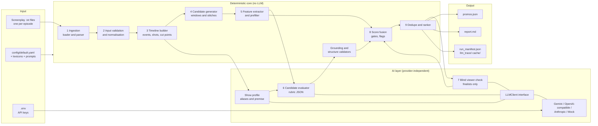
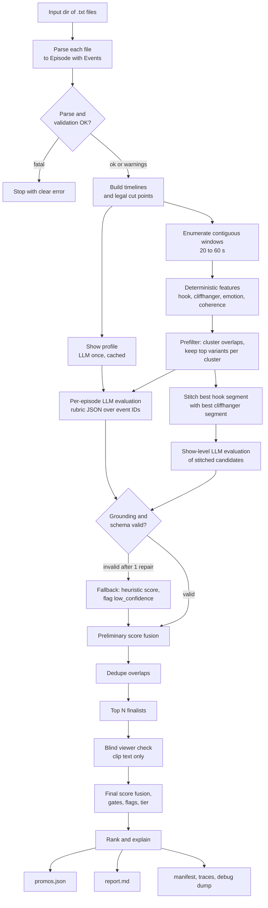

# Promo Finder — Architecture

> Kuku AI Generalist Assignment · Problem 1: *Find the Promos (Ads)*
> Status: **design only** — nothing is implemented yet. Items tagged **[MVP]** are in scope for the first build. Items tagged **[Future]** are deliberately deferred.

---

## 1. Project Overview

**Promo Finder** reads microdrama screenplay transcripts and recommends the best 20–60 second promo clips: each opens on a hook, ends on an unresolved cliffhanger, and makes sense to someone who has never seen the show. For every promo it reports episode(s), start/end timestamp of every segment, hook, cliffhanger, a one-line "why it works", a transparent score, and a rank. It also reports where its own recommendation is likely to be wrong.

**Core design idea — split the work by what each side is good at:**

| Deterministic Python | LLM |
|---|---|
| Parse files, own every timestamp, enumerate *legal* clips, measure duration, check cut points, dedupe, combine scores, rank, validate | Judge *story* qualities that rules cannot: is this a shocking reveal, is the question really unresolved, would a stranger understand it |

**Why this split:** timestamps are the one thing an LLM must never be trusted with (it will invent them), while "is this a good hook" is the one thing regex cannot answer. Every promo is therefore a *deterministically generated, deterministically validated* window that the LLM only **scores and describes by referencing event IDs**.

**Assignment deliverables → what this system produces**

| Assignment deliverable | Produced by |
|---|---|
| Prototype (runnable, model-swappable, re-runnable on a new input in the interview) | CLI: `python -m promo_finder run --input <dir>` |
| Raw, unedited outputs on the full input pack | `outputs/<run_id>/` (JSON + report + LLM traces) |
| Promos with episode, segment timestamps, hook, cliffhanger, why-it-works, ranking | `promos.json` + `report.md` |
| "Where does your tool pick badly?" | Per-promo `risks`/`flags` + a "Known limitations" section in every report + `eval/` results |
| 2-page solution doc, walkthrough video | Out of scope for this file (written by the author; this document is the source material) |

---

## 2. Problem Statement

Today an editor watches every episode of every show and hand-picks promo moments. Kuku releases new shows every week, so this does not scale.

A **promo** is a 20–60 s clip taken from the show itself, posted on Instagram/TikTok/YouTube to pull in new viewers. It is usually one continuous stretch but may join several moments, within one episode or across episodes. A good promo:

1. **Hooks** in the first ~3 s (a slap, a reveal, a shocking line).
2. **Ends on a cliffhanger** — cut at an unresolved moment.
3. **Stands alone** — intelligible to a viewer who has never seen the show.

**The task:** find the right moments and the right start/end points (no editing, music or overlays), rank them, and show honestly where the tool fails.

**What makes it hard**

- Input is **text only** (screenplay with timestamps). No video, audio or acting is visible; the tool must infer "shocking" from words and action descriptions.
- "Good promo" is **subjective** and there is **no labelled ground truth**.
- LLMs **hallucinate timestamps, quotes and events**, so naive "ask the LLM for the best clips" is untrustworthy and untraceable.
- The pack is **50 episodes of one show now, many shows later**; the solution must generalise without per-show code.

---

## 3. Functional Requirements

| ID | Requirement | Priority |
|---|---|---|
| FR-01 | Read all screenplay `.txt` files from an input directory; order them by episode number, not by filename | MVP |
| FR-02 | Parse the observed format (see §5.1): episode header, scenes, `CAMERA`/`ACTION`/`SOUND FX`/dialogue blocks with `Start`/`End` timestamps | MVP |
| FR-03 | Tolerate formatting inconsistencies and missing fields; emit warnings instead of crashing | MVP |
| FR-04 | Normalise into one internal event model that preserves original timestamps and episode references | MVP |
| FR-05 | Build a per-episode timeline and a set of *legal cut points* (never mid-dialogue) | MVP |
| FR-06 | Generate every contiguous candidate window with 20 ≤ duration ≤ 60 s | MVP |
| FR-07 | Generate multi-segment candidates (≤ 2 segments in MVP) within one episode and across episodes, chronological order | MVP (staged, see §16.2) |
| FR-08 | Compute deterministic hook, cliffhanger, emotion, coherence, duration features per candidate | MVP |
| FR-09 | Prune candidates deterministically before any LLM call | MVP |
| FR-10 | Score each remaining candidate with an LLM on a fixed rubric via a provider-independent interface | MVP |
| FR-11 | Run a "blind viewer" standalone-understandability check on finalists | MVP |
| FR-12 | Combine deterministic and LLM scores into one transparent, normalised, reproducible score | MVP |
| FR-13 | Deduplicate overlapping/near-identical promos | MVP |
| FR-14 | Rank promos best → worst and explain why the top ones should be posted first | MVP |
| FR-15 | Output `promos.json` and a human-readable `report.md` containing every required field | MVP |
| FR-16 | Validate timestamps, durations, quotes and event references; reject or flag, never silently repair | MVP |
| FR-17 | Flag weak promos and list likely failure situations per promo and globally | MVP |
| FR-18 | Work with no API key in a degraded "heuristic-only" mode | MVP |
| FR-19 | Evaluate the tool against a small hand-made gold set and invariants | MVP (lightweight) |
| FR-20 | Capture editor accept/reject feedback to recalibrate weights | Future |

---

## 4. Non-Functional Requirements

| ID | Requirement | Why |
|---|---|---|
| NFR-01 **Traceability** | Every timestamp in the output equals an actual event boundary in a source file, and the output carries source event IDs | Editors must be able to find the exact moment; also the primary anti-hallucination guard |
| NFR-02 **Provider independence** | Swapping model/provider is a config change, not a code change | Brief says stronger models may be connected via provided APIs on interview day |
| NFR-03 **Reproducibility** | Same input + config + model ⇒ same candidates, same deterministic scores; LLM calls cached on content hash, temperature 0 | Needed for evaluation and for the interview re-run |
| NFR-04 **Free-tier friendly** | Total LLM usage for 50 episodes should be on the order of ~100–200 calls (estimate in §10.7) | Brief: free tiers are enough |
| NFR-05 **Runs locally, simple** | `pip install` + one command; no database, queue or server | Avoid over-engineering |
| NFR-06 **Graceful degradation** | LLM failure never loses an episode: fall back to heuristic scores with a `low_confidence` flag | A partial honest result beats a crash |
| NFR-07 **Transparency** | Every score is decomposable into components visible in the output | Brief rewards honest quality-checking over polish |
| NFR-08 **No show-specific code** | No episode, character or plot names in source; per-show data lives in generated/edited config | New shows weekly |
| NFR-09 **Secrets hygiene** | API keys only from environment variables / `.env` (git-ignored) | Standard security practice; explicit requirement |
| NFR-10 **Confidentiality** | Input pack is git-ignored and never uploaded anywhere but the chosen LLM API | Brief: input pack is Kuku's confidential content |

---

## 5. Assumptions and Constraints

### 5.1 Inspected input pack — facts that drive the design

Inspected: the assignment PDF and three transcripts (`episode-001-Episode_1671703.txt`, `-002-…1671704.txt`, `-003-…1671705.txt`, UTF-8, LF line endings, 310–500 lines each).

| # | Observation | Design implication |
|---|---|---|
| O1 | Header lines: `EPISODE NUMBER: Episode N`, `EPISODE LOGLINE:`, `CONTINUITY NOTES:`, then `--- SCRIPT START ---` … `--- SCRIPT END ---` | Header key/value parser + body delimiters. Logline and continuity notes are free, cheap per-episode summaries and a cross-episode link (Ep 2: "Picks up directly from Episode 1's cliffhanger") |
| O2 | File name holds a zero-padded index (`001`) *and* a long numeric ID (`1671703`) | Episode number comes from the header; filename is the fallback; the numeric ID is kept as `source_id`; mismatch ⇒ warning |
| O3 | Scenes: `SCENE NN` / `Scene heading:` / `Scene start:` / `Scene end:` (Ep 1–2 have 1 scene, Ep 3 has 3). Headings use `–`/`—` (non-ASCII) | Scene boundaries are available as validation bounds; normalise Unicode dashes/quotes |
| O4 | Entry blocks look like `**LABEL (annotations):**` + `Start: (MM:SS.ss) \| End: (MM:SS.ss)` + free text on the next line(s). Labels: `CAMERA`, `ACTION`, `SOUND FX`, otherwise a character/role name (dialogue, text in straight quotes) | One regex-driven block parser. Non-reserved label ⇒ dialogue |
| O5 | Timestamps are **episode-relative**, `MM:SS.ss` with 2 decimals (e.g. `02:25.75`). No hours seen | Parse to float seconds; also accept `HH:MM:SS.ss` and `SS.s` defensively. Cross-episode clips therefore need `(episode, time)` pairs, never a global clock |
| O6 | Episodes are ~1:50–2:26 long (a 20–60 s promo is ~15–50 % of an episode) | Candidate space per episode is small (thousands of windows) ⇒ **exhaustive enumeration is affordable**; no need to ask an LLM to "find" clips |
| O7 | **Blocks overlap in time.** `CAMERA` blocks form a near-contiguous shot list; `ACTION`/dialogue/`SOUND FX` run concurrently with them | Treat `CAMERA` as *shots* (visual context + natural cut points) and everything else as *beats* (the story). Do not assume a single linear sequence |
| O8 | A dialogue line can **span several shots** (e.g. Ep 2 `01:26.80–01:33.00` crosses a shot boundary at `01:30.80`; Ep 2 `01:19.20–01:22.50` crosses `01:21.80`) | Cut-point rule: a clip may not start or end strictly inside a dialogue interval |
| O9 | The speaker label is a **role description in parentheses-annotated form**: `LADY JULIANA (Confused, Breathless)`, `MATRIARCH (O.S.) (Firm)`, `THE FORMER GROOM (Off-screen) (Dismissive)`. The first parenthetical may be a modifier (`O.S.`, `Off-screen`) or an emotion | Parse annotations into `modifiers` and `delivery` tags; delivery tags (e.g. *Outraged, Gloating, Trembling*) are a ready-made emotion signal |
| O10 | **Speaker names are not stable.** The same person appears as `MATRIARCH` / `NOBLE MATRIARCH` / `OFF-SCREEN VOICE`; `LADY IN GOLD GOWN` is named "Clarissa" only in other text; `THE FORMER GROOM` is "Gerald"; `BLOND NOBLEMAN` (Ep 2) appears to be the father of Ep 1 | Do **not** key anything on speaker strings. Alias resolution is an LLM-assisted, human-editable, per-show profile used for *display and prompts only* |
| O11 | Hooks in the data are uneven: Ep 1 has ~11 s with no dialogue (door opening) before the first line; Ep 2 opens directly on a shocking line (`00:00.00`) | The 3-second hook must be measured **from the candidate's own start**, and quiet openings must score low rather than be assumed fine |
| O12 | Cliffhangers are uneven: Ep 1 ends with an explicit "cut to black" + `SOUND FX` mentioning a cliffhanger; Ep 3 ends on a proposal; **Ep 2 ends on a triumphant, fairly resolved statement** | An episode ending is a *soft* cliffhanger prior, never an automatic one |
| O13 | Source timestamps appear internally consistent (no inverted `Start`/`End`; scene end = last block end in all 3 files) | Use scene/episode end as a validation bound; still validate, since a new input may be dirtier |
| O14 | The brief says the pack contains **50 episodes**; this working sample has **3** | Design for 50+ and test on 3. Behaviour on episodes 4–50 is unverified |

### 5.2 Assumptions (made instead of asking, per the brief)

| ID | Assumption | Consequence if wrong |
|---|---|---|
| A1 | Script timestamps match the finished video's timeline | Every cut point could be off; tool cannot detect it |
| A2 | A promo's segments are shown in chronological order (episode, then time) | Non-chronological montages are never proposed |
| A3 | "Hook in the first 3 s" is operationalised as: a dialogue line or a striking action **begins within the first ~1.5 s** and the first 3 s contain a shocking/emotional beat | May mis-score hooks that are purely visual |
| A4 | "Unresolved" is judged from text only, but the tool *can see what comes next in the source* (e.g., the clip ends on a question and the answer is the next line) | Over-trusts text; a visually resolved scene may look unresolved |
| A5 | Preferred duration is a soft plateau of **25–45 s** inside the hard **20–60 s** range | Config value; trivially changed |
| A6 | English-only for MVP lexicons; other languages need a different lexicon file (LLM layer is language-agnostic) | Deterministic features degrade for non-English shows until a lexicon is added |
| A7 | Spoilers are acceptable (promos may reveal mid-episode twists) | May need an editor policy |
| A8 | Scoring weights/thresholds are **starting values**, not tuned; no labelled data exists | Documented as untuned; recalibrated via the gold set (§14) |
| A9 | Any episode can be a promo source, including late ones; the "never watched" criterion is enforced through the standalone score, not by favouring early episodes | Late-episode promos with heavy backstory will score low on standalone, which is intended |

### 5.3 Constraints

- Python backend, local execution, free-tier APIs only; keys via environment variables; no hard-coded episode data.
- Input pack must not be published; commit only code/config. *(Note: raw output files quote screenplay text — share them privately or by restricted link.)*
- ~2–3 hours of build time suggested by the brief ⇒ the MVP must be small (see build order, §16.2).

---

## 6. Proposed Technology Stack

| Concern | Choice | Why | Alternative considered |
|---|---|---|---|
| Language | Python 3.11+ | Brief prefers Python; best LLM/tooling ecosystem | — |
| Data models & validation | `pydantic` v2 | Validates both parsed input and **LLM JSON output** with one tool; emits JSON Schema for structured-output APIs | `dataclasses` + manual checks (more code, weaker LLM-output validation) |
| Config | YAML (`PyYAML`) + env vars | Human-editable weights/lexicons/prompts-paths; secrets stay in env | TOML (fine, no real difference) |
| CLI | `argparse` (stdlib) | Zero dependency | `typer` (nicer, one extra dep) |
| LLM access | Thin internal `LLMClient` protocol + 3 adapters: **Gemini** (`google-genai`), **OpenAI-compatible** (`openai` SDK with `base_url`), **Anthropic** (`anthropic`) | OpenAI-compatible adapter alone covers OpenAI, OpenRouter, Groq, Together, local Ollama/vLLM, so one adapter ≈ most free tiers and local models; Gemini has a free tier; Anthropic adapter covers a stronger provider if supplied | LangChain/LlamaIndex (heavy, leaky abstractions, unnecessary here) |
| Offline / tests | `MockLLM` adapter (canned/deterministic) | Run with no key; unit-test the pipeline | — |
| Caching | JSON files keyed by SHA-256 of `(prompt_version, model, input)` | Free, inspectable, no DB; makes reruns instant and cheap | SQLite (only worthwhile at far larger scale) |
| Text normalisation | stdlib `re`, `unicodedata`; `difflib`/token-set ratio for quote matching | Enough for exact/near-exact verbatim checks | `rapidfuzz` (optional speed-up) |
| Tests | `pytest` | Standard | — |
| Report | Plain Markdown generated from JSON | Readable anywhere, diffable, no UI to maintain | Streamlit viewer **[Future]** (useful for demo, not required) |

**Deliberately not used:** vector DB/embeddings (episodes are ~2 min; whole show fits in context), agent frameworks, queues, web server, fine-tuning. None is needed to meet the brief.

---

## 7. High-Level System Architecture



**Trust boundaries (why the diagram is shaped this way)**

| Responsibility | Owner | Why |
|---|---|---|
| Timestamps, durations, cut points, which windows exist | Deterministic code only | LLMs invent numbers; code can be tested |
| Quote/event existence | Deterministic validator checks every LLM claim against the source | Hallucinated dialogue must be caught mechanically |
| Judging reveal/twist/emotion/unresolved question/comprehensibility | LLM | Requires language understanding |
| Combining scores, gating, ranking, dedupe | Deterministic code | Transparent, tunable, repeatable |
| Boundaries of the LLM's authority | LLM output is a **JSON object over candidate IDs and event IDs**, validated by pydantic | The model cannot add a clip, move a boundary, or cite a line that is not in the candidate |

---

## 8. Detailed Component Architecture

All components are plain Python modules with typed inputs/outputs so any stage can be unit-tested or replaced alone.

### 8.1 Ingestion — `ingestion/` **[MVP]**

| Part | Responsibility | Why |
|---|---|---|
| `loader.py` | Glob `*.txt` (configurable pattern), read UTF-8 (fallback `utf-8-sig`, `latin-1` with warning), return `RawEpisode(path, text)` | Pack-agnostic; no hard-coded names |
| `parsers/base.py` | `FormatParser` protocol: `detect(text) -> float` confidence, `parse(raw) -> Episode` | New formats = new parser class, not a rewrite |
| `parsers/kuku_screenplay.py` | The one MVP parser (format in §5.1). Line-based state machine: header → `--- SCRIPT START ---` → scene header → entry blocks. Entry = a `**…:**` line, then a `Start:/End:` line, then text lines until blank line / next `**` / next `SCENE` | Format is regular enough for deterministic parsing; no LLM needed or wanted |
| `parsers/registry.py` | Picks the highest-confidence parser; if none ≥ threshold, fails with a clear message | Honest failure beats wrong parse |

Parsing rules:

- **Label classification:** reserved labels `CAMERA`, `ACTION`, `SOUND FX` (case-insensitive, configurable). Anything else ⇒ dialogue with `speaker_raw`.
- **Annotations:** parenthetical groups after the label are split into `modifiers` (`O.S.`, `V.O.`, `Off-screen`) and `delivery` tags (everything else).
- **Dialogue text:** the quoted string; multi-line tolerated; surrounding quotes stripped.
- **Timestamps:** `MM:SS.ss`, `HH:MM:SS.ss`, `SS.ss` → float seconds. Original string kept in `*_raw` for display.
- **Missing fields:** block without `Start`/`End` ⇒ dropped with a warning (never guessed). Missing `End` but valid `Start` ⇒ `end = start` flagged `end_inferred`. Missing episode header ⇒ number from filename. Missing scene block ⇒ synthetic single scene bounded by min/max event time.
- **Episode metadata:** `EPISODE NUMBER`, `EPISODE LOGLINE`, `CONTINUITY NOTES` captured verbatim.

### 8.2 Input validation & normalisation — `ingestion/validators.py`, `preprocess/normalizer.py` **[MVP]**

Checks per episode (all produce structured `Warning` records stored in `episodes.json`):

| Check | Action |
|---|---|
| `end < start` | Drop event, warn |
| Event outside scene/episode bounds | Warn; keep if < tolerance, else drop |
| Duplicate episode numbers | Error naming both files |
| Missing episode numbers in sequence (e.g., 1,2,4) | Warn: cross-episode continuity may be broken |
| Dialogue words-per-second outside a sane range (default 0.8–6) | Warn `suspicious_timing` — detects bad timestamps in the *source*, not just in AI output |
| Large gaps in the shot timeline (> 2 s) | Warn `timeline_gap` |
| Filename vs header episode mismatch | Warn, trust header |

Normalisation: Unicode NFKC, dash/quote/ellipsis unification (`–`, `—`, `…`, curly quotes), whitespace collapse; the **original text is preserved** next to a `norm_text` field used only for matching. *Why:* preserve source fidelity for output, normalise only for comparisons.

### 8.3 Timeline builder — `preprocess/timeline.py` **[MVP]**

Produces, per episode:

- `events`: all entries, sorted by `(start, end)`, with stable IDs `E{ep:03d}:{idx:03d}` (e.g. `E001:017`).
- `shots`: `CAMERA` events. `beats`: all other events.
- `dialogue_intervals`: used for the cut-safety rule.
- `cut_starts` / `cut_ends`: legal clip boundaries (rule in §11.1).
- **Context links:** previous/next beat for each event, and `episode_link` (this episode continues the previous one, from `CONTINUITY NOTES` keywords like "picks up", "follows directly") used only as a hint for stitching and for the LLM.

*Why event IDs:* the LLM and the validators speak in IDs, so every claim can be checked by dictionary lookup and traced to a line in a file.

### 8.4 Show profile — `preprocess/profile.py` **[MVP, LLM-assisted, cached]**

One LLM call per show builds `shows/<slug>/profile.yaml`:

```yaml
premise: "<2-3 sentences, synthesised from loglines>"
characters:
  - canonical: "<name>"
    aliases: ["<speaker label>", "<other label>"]   # unresolved ones marked unknown
```

- Inputs: all loglines + continuity notes + the set of distinct speaker labels. Output validated by pydantic.
- **Human-editable and cached**: an editor can fix aliases once; reruns reuse it.
- Used **only** to make prompts and report text readable (e.g., "Lady in Gold Gown (Clarissa)"). It never affects timestamps or candidate generation.
- Why: speaker labels are inconsistent (O10). Reading raw labels, a model may think three "matriarchs" are different people. Why not code it: names appear only in free text, so it is a language task. Why optional: if it fails, the pipeline still runs with raw labels.

### 8.5 Candidate generator — `candidates/` **[MVP]**

| Module | Responsibility |
|---|---|
| `cutpoints.py` | Compute legal starts/ends (§11.1) |
| `generator.py` | Enumerate all `(start, end)` with `min_dur ≤ end − start ≤ max_dur`; attach `event_ids` fully inside the window |
| `features.py` | Deterministic feature extraction (§11.4) |
| `prefilter.py` | Score → cluster overlapping windows → keep top variants per cluster → keep top-M clusters per episode |
| `stitch.py` | Build ≤ 2-segment candidates from the best hook-segments and best cliffhanger-segments (§11.3) **[MVP stage 2]** |

*Why enumerate instead of asking the LLM to find moments:* the search space is tiny (O6), enumeration cannot miss a legal clip, and every candidate is guaranteed to satisfy duration/cut rules by construction.

### 8.6 LLM layer — `llm/` **[MVP]**

| Part | Responsibility |
|---|---|
| `base.py` | `LLMClient` protocol: `generate_json(prompt, schema, *, system, temperature, max_tokens) -> LLMResult(parsed, raw, usage)` |
| `providers/*.py` | `gemini.py`, `openai_compat.py`, `anthropic.py`, `mock.py` |
| `factory.py` | Build a client from `config.llm` + env vars; supports **two model slots**: `eval_model` (cheap, high volume) and `finalist_model` (stronger, low volume) |
| `prompts.py` | Loads versioned prompt templates from `config/prompts/*.md`; renders compact transcripts |
| `schemas.py` | Pydantic models for each prompt's JSON output |
| `cache.py` | Content-hash cache + raw trace logging |
| `retry.py` | Exponential backoff on 429/5xx, one JSON-repair retry, per-provider rate limiter |

### 8.7 Evaluation (runtime) & scoring — `scoring/`, `validation/` **[MVP]**

- `validation/grounding.py`: checks every LLM claim against the source (§13.2).
- `scoring/scorer.py`: fuses deterministic + LLM components (§11.7).
- `scoring/flags.py`: risk flags (§11.8).
- `scoring/dedupe.py`, `scoring/ranker.py`: overlap removal and ordering (§11.9).

### 8.8 Output generation — `reporting/` **[MVP]**

- `json_writer.py`: validated `promos.json`, `episodes.json` (parse report), `candidates_debug.json` (all scored candidates incl. rejected, with reasons), `run_manifest.json`.
- `markdown_report.py`: ranked, human-readable report (§12.5).

*Why a debug dump of rejected candidates:* the brief asks "where does your tool pick badly?" — a reviewer can only judge that if they can see what was passed over.

### 8.9 Orchestration — `pipeline.py`, `cli.py` **[MVP]**

A single linear function per stage with explicit inputs/outputs; per-episode stages run in a small thread pool. No workflow engine. *Why:* the dependency graph is a straight line with one fan-out (per-episode) and one fan-in (show-level ranking).

---

## 9. End-to-End Data Flow



| Stage | Input | Output | LLM? |
|---|---|---|---|
| 1 Load/parse | `*.txt` | `Episode[]` + warnings | No |
| 2 Validate/normalise | `Episode[]` | clean `Episode[]` | No |
| 3 Timeline | `Episode` | events, shots, cut points | No |
| 3b Profile | loglines, labels | `profile.yaml` | Yes (1 call/show, cached) |
| 4 Generate | timeline | all legal windows | No |
| 5 Features + prefilter | windows | ≤ ~15–20 candidates / episode | No |
| 6 Evaluate | candidates + compact transcript | rubric scores, hook/cliffhanger text, risks | Yes (~1 call/episode) |
| 6b Validate | LLM JSON | accepted / repaired / rejected | No |
| 7 Prelim score, dedupe, pick finalists | all scores | top-N | No |
| 8 Blind check | clip text only | standalone score, confusion list | Yes (small) |
| 9 Final score, rank | all components | ranked promos | No |
| 10 Output | ranked promos | JSON + Markdown + manifest | No |

**Worked trace (illustrative, using real timestamps from Episode 1; scores not computed here):**

- *Window A:* `00:11.00 → 00:50.40` (39.4 s). Legal start: a shot boundary, and the first dialogue (`MATRIARCH: "You should turn around, Juliana."`) starts 0.3 s later. Legal end: end of the shot that follows the outraged line `"You knew this before I walked through those doors!"` (ends at `00:50.00`); no dialogue spans `00:50.40`. Deterministic hook feature: high (speech inside first second, command + name). Cliffhanger feature: moderate (ends on an accusation with no answer yet; the next line is a short reply, `"I changed my mind."`, 10 s later).
- *Window B:* `00:00.00 → 00:40.00`. First dialogue only at `00:11.30`; the first 3 s hold only a camera move and a calm action description ⇒ hook feature ≈ 0 ⇒ weakest-link penalty (§11.7), even if the rest of the window is strong.
- *Episode 2 ending:* last events are a defiant declarative line and a calm action (*"holding her head high as the … score swells into the final beat"*): no question, no ellipsis, no explicit cut-to-black cue ⇒ expected cliffhanger score low; this is exactly the case the tool must flag as `WEAK_CLIFFHANGER` instead of assuming "end of episode = cliffhanger".

---

## 10. AI/LLM Integration Strategy

### 10.1 What the LLM does and does not do

| LLM **does** | LLM **does not** |
|---|---|
| Rate hook, cliffhanger, emotion, coherence, standalone on an anchored 1–5 rubric | Choose or alter start/end times |
| Name the hook beat and cliffhanger beat **by event ID** and quote them verbatim | Invent dialogue, characters, or events |
| Say what is left unresolved; write a one-line "why it works" | Decide the final score or rank |
| List weaknesses and "things a new viewer would not understand" | Add candidates the code did not generate |
| (Once per show) draft the alias/premise profile | Be required for the pipeline to run |

### 10.2 Provider-independent interface **[MVP]**

```python
class LLMClient(Protocol):
    name: str
    def generate_json(self, *, system: str, prompt: str,
                      schema: type[BaseModel],
                      temperature: float = 0.0,
                      max_tokens: int = 4096) -> LLMResult: ...
# LLMResult: parsed: BaseModel | None, raw_text: str, usage: Usage, model: str
```

- Pipeline code imports **only** `LLMClient`. Provider specifics (auth, JSON mode vs tool-use, rate limits) live in one adapter file each.
- Provider/model chosen by config + env: `PROMO_LLM_PROVIDER`, `PROMO_LLM_MODEL`, `PROMO_FINALIST_MODEL`, `GEMINI_API_KEY` / `OPENAI_API_KEY` / `ANTHROPIC_API_KEY`, optional `OPENAI_BASE_URL` (OpenRouter, Groq, Ollama, …).
- Structured output: use the provider's JSON/schema mode when available; otherwise instruct JSON-only and parse with the pydantic schema. One repair retry ("your JSON failed validation: <errors>; return corrected JSON only").
- **Why not LangChain:** one narrow call shape (prompt → validated JSON) does not justify a framework.
- **Why two model slots:** cheap model for ~50 per-episode calls, stronger model (if provided on interview day) for finalists and blind checks — best quality where it matters, lowest cost where volume is.

### 10.3 Prompts (versioned files in `config/prompts/`)

| Prompt | Receives | Returns | Notes |
|---|---|---|---|
| `profile.md` | loglines, continuity notes, distinct speaker labels | premise, alias map | Marks unknown aliases as `null` rather than guessing |
| `evaluate.md` | Compact episode transcript with event IDs (incl. camera and action text, because hooks can be visual), show profile, candidate list as `{cand_id, start_event_id, end_event_id, duration}` | Per candidate: 1–5 scores (hook, cliffhanger, emotion, coherence, standalone), `hook{event_id, quote, description}`, `cliffhanger{event_id, quote, description, unresolved_question}`, `why_it_works`, `weaknesses[]`, `reject`+`reason` | Transcript sent **once**, candidates referenced by ID ⇒ cheap. Temperature 0. Rubric anchors embedded (§11.6) |
| `evaluate_stitched.md` | The ordered segments of each stitched candidate, with the join marked | Same schema + `join_makes_sense` | Show-level call |
| `blind.md` | **Only** the clip's events in order (no loglines, no profile, no other episodes) | `who_what_stakes` summary, `unanswered_questions[]`, `standalone` 1–5 | Simulates a viewer who has never seen the show |

**Why a separate blind pass:** when the evaluator sees the whole episode and the loglines, it *knows* the story and will rate almost any clip as understandable ("context leakage"). The blind pass removes that knowledge. It runs only on finalists because it is the most expensive call per candidate.

### 10.4 Anti-hallucination controls

1. LLM never outputs timestamps; boundaries come from code.
2. Hook/cliffhanger `event_id` must be inside the candidate's event range.
3. Quotes must be a normalised substring of that event's text (§13.2).
4. Named entities in descriptions must appear in the source or profile.
5. Temperature 0; schema-validated output; invalid → one repair → fallback (never "best effort" fabrication).
6. Candidate count per call is capped (default 15–20) to limit position bias; order is shuffled with a fixed seed so position bias is the same in every run and does not systematically favour early windows.

### 10.5 How deterministic logic and the LLM cooperate

```
code: all legal windows ──► code: cheap features + prefilter (cut ~thousands → ~15–20/ep)
      ──► LLM: rubric + explanations over IDs ──► code: validate/ground
      ──► code: fuse with deterministic features (disagreement ⇒ flag)
      ──► LLM: blind check on finalists ──► code: final score, dedupe, rank
```

Deterministic features act as a **sanity anchor** for each LLM dimension: when LLM and rules disagree strongly (|Δ| > 0.35 on a 0–1 scale) the promo is flagged `LLM_DET_DISAGREE` for human review instead of one side silently winning.

### 10.6 Failure & fallback behaviour

| Failure | Behaviour |
|---|---|
| No API key / provider down | **Heuristic-only mode**: LLM weights set to 0, hook/cliffhanger text generated from templates over the actual quoted lines, every promo flagged `NO_LLM` |
| Rate limited (429) | Backoff, then slow down; cached results are never re-requested |
| Invalid JSON / schema | One repair retry, then candidates in that batch fall back to heuristic scores and are flagged `LLM_INVALID` |
| Ungrounded quote | That field is replaced by a verified quote chosen by code; promo flagged `UNGROUNDED_LLM_TEXT` and its LLM component down-weighted |

### 10.7 Cost estimate (rough; verify against provider limits at build time)

| Item | Estimate for 50 episodes |
|---|---|
| Profile | 1 call |
| Per-episode evaluation | ~50 calls, each ≈ 3–6 K tokens in, ≈ 2–4 K out |
| Stitched-candidate evaluation | 1–3 calls |
| Blind checks on finalists | ~20–50 short calls (or batched) |
| **Total** | **~100–150 calls**, order of 0.5 M tokens — realistic for a free tier spread over a short time, and trivially cacheable |

Cost grows linearly with episode count because the prefilter fixes the number of candidates per episode.

---

## 11. Candidate Generation and Ranking Algorithm

### 11.1 Legal cut points

Let `D` = dialogue intervals `[ds, de]`, `ε = 0.05 s`.

- A time `t` is **dialogue-safe** if no `d ∈ D` satisfies `ds + ε < t < de − ε`.
- **Legal starts:** `{shot.start} ∪ {beat.start}` that are dialogue-safe, **and** the first beat in the clip begins within `lead_in` (default 1.5 s) — no dead air at the start.
- **Legal ends:** `{beat.end} ∪ {shot.end}` that are dialogue-safe, **and** the last beat ended within `tail_hold` (default 1.5 s) before the cut — no trailing dead air; plus scene/episode end.

*Why:* a clip cut in the middle of a sentence is unusable (O8), and long silent heads/tails waste the 3-second hook window. These rules are about *editorial usability*, so they are rules, not LLM judgments.

### 11.2 Contiguous windows

For each legal start `s` and legal end `e`: keep if `20 ≤ e − s ≤ 60`. Typical result: hundreds to a few thousand windows per episode (O6). Each gets `event_ids`, `shots`, `beats`, `scene_ids`.

### 11.3 Stitched candidates **[MVP stage 2]**

1. From the per-episode prefilter, take the **top H hook segments** (8–25 s, strong first-3-s hook, any ending) and **top C cliffhanger segments** (8–25 s, strong ending, any start), H = C = 5 per show.
2. Combine ordered pairs `(hook_seg, cliff_seg)` where `hook_seg` precedes `cliff_seg` chronologically (same episode with a gap, or a later episode), and total duration is 20–60 s.
3. Same-episode pairs must be separated by a gap ≥ `min_gap` (default 5 s) — otherwise it is just a contiguous window.
4. Cap at ~20 stitched candidates per show; send to the show-level LLM call, which also scores `join_makes_sense`. Poor joins are penalised through the **coherence** dimension.

*Why restricted:* unrestricted combinations explode combinatorially and mostly make no narrative sense. The brief says single-segment is the usual case, so stitching is a bounded add-on. 3+ segments are **[Future]**.

### 11.4 Deterministic features (each mapped to [0,1])

All lexicons live in `config/lexicons/<lang>.yaml` (replaceable per show/language).

| Dimension | Features (examples) | Notes |
|---|---|---|
| **Hook** (first 3 s) | speech or striking action starts within 1 s; speech present in first 3 s; intensity of delivery tags (e.g., *Outraged, Gasping, Cold*) ; shock/reveal/command/accusation terms; `!`/`?`; second-person address ("you …"); **penalties:** only camera/establishing in first 3 s, opens with a conjunction/pronoun-only line ("And you knew?") | Quiet openings score low by design (O11) |
| **Cliffhanger** (last ~5 s) | final dialogue is a question or ends with `…`; final beat is a reveal/threat/proposal/confession term; **the next source beat is an answer/reaction that was *cut off*** (strong signal: we cut right before the payoff); clip ends at episode end with cut-to-black / ominous SFX cue; **penalties:** final beat is calm resolution ("steady resolve", "peace"), clip ends where a conflict is already answered | End-of-episode is a *bonus*, not a pass (O12) |
| **Emotion** | mean and peak delivery-tag intensity; speaker alternation count (conflict density); words/second; exclamation density; emotion/violence lexicon hits | Delivery tags are an unusually clean signal in this format (O9) |
| **Coherence (det.)** | no mid-dialogue cuts (guaranteed); scene-boundary crossings; for stitches: number of joins and same-episode vs cross-episode | The LLM supplies the semantic part |
| **Standalone (det. proxy)** | ≥ 2 distinct speakers; opening line is not a pronoun-only reply; speakers referenced by name/role in the clip | Weak proxy; the blind pass dominates (α = 0.8) |
| **Duration** | hard gate 20–60 s; soft plateau 25–45 s | Config |

Each feature is clipped to `[0,1]` with a documented cap (e.g., `min(1, count / cap)`); the dimension score is a weighted mean of its features.

**Why bounded transforms rather than corpus min-max:** min-max over a small or new input (3 episodes today, a different show tomorrow) would make scores depend on whatever else happened to be in the batch. Fixed transforms keep a promo's deterministic score stable across runs.

### 11.5 Prefilter and clustering

1. `prefilter_score = Σ w · det_dimension` (same weights as §11.7, no LLM).
2. **Cluster** windows on the same episode with temporal IoU > 0.5; within each cluster keep up to `variants_per_cluster` (default 3) with *different* start/end cut points (so the LLM can choose the better boundary rather than judge near-identical clones).
3. Keep the top `clusters_per_episode` clusters (default 6) ⇒ ≤ ~18 candidates / episode.

*Why:* cuts LLM load by 2–3 orders of magnitude while preserving boundary alternatives for the best moments.

### 11.6 LLM rubric (anchored, 1–5)

| Score | Hook (first 3 s) | Cliffhanger (final beat) |
|---|---|---|
| 1 | Nothing happens/establishing shot | Scene visibly resolved |
| 2 | Mild dialogue, no tension | Question mostly answered or vague |
| 3 | Clear conflict but expected | Open thread but low stakes |
| 4 | Surprising line/action; makes you ask "what?" | Strong open question; viewer wants the answer |
| 5 | Shock/reveal/violence in first seconds | Cut at the peak of a reveal/threat; answer clearly withheld |

Equivalent anchored rows are defined for *emotion*, *coherence* (does the clip tell one understandable mini-story?) and *standalone* (could a stranger state who/what/stakes?). Anchors are in the prompt so scores are comparable across batches. `LLM 1–5 → (x − 1) / 4`.

### 11.7 Score fusion & normalisation

Per dimension `i ∈ {hook, cliff, emotion, coherence, standalone}`:

```
s_i = α_i · llm_i + (1 − α_i) · det_i          # both in [0,1]
```

Starting config (untuned — A8):

```yaml
weights:      {hook: 0.25, cliffhanger: 0.25, standalone: 0.20, emotion: 0.15, coherence: 0.10, duration: 0.05}
llm_share:    {hook: 0.5,  cliffhanger: 0.6,  standalone: 0.8,  emotion: 0.5,  coherence: 0.7}   # α_i
duration:     {hard_min: 20, hard_max: 60, soft_min: 25, soft_max: 45, edge_score: 0.6}
weakest_link: {dims: [hook, cliffhanger, standalone], floor_penalty: 0.6, knee: 0.5}
tiers:        {A: 75, B: 60}
```

```
base    = Σ_i  w_i · s_i                                   # i includes duration
penalty = min(1, floor + (1 − floor) · min(s_hook, s_cliff, s_standalone) / knee)
SCORE   = 100 · base · penalty
```

- **Hard gates (reject, not penalise):** duration outside 20–60 s; cut inside dialogue; any segment outside source bounds; ungrounded hook/cliffhanger *and* no code fallback available.
- **Weakest-link penalty:** a promo with a superb cliffhanger but no hook (or vice versa) **fails the brief**, so a weighted average alone would over-rank it. The penalty applies only when one of the three *must-have* dimensions is low.
- **Standalone LLM value:** the blind score if present; if only the in-context score exists it is capped at 0.75 (context leakage, §10.3).
- **No-LLM mode:** `α_i = 0`, tier cannot exceed B, flag `NO_LLM`.
- **Calibration check:** per-episode mean LLM score vs global mean; if differing by > 1.0 point, flag `CALIBRATION_DRIFT` for that episode (batches are scored independently, so drift is possible).
- **Reporting normalisation:** the within-run percentile of `SCORE` is shown for readability only; it never feeds the ranking.

**Illustrative arithmetic (invented numbers, to show the mechanics):** `s = {hook .85, cliff .70, standalone .65, emotion .80, coherence .75, duration 1.0}` → `base = .25·.85 + .25·.70 + .20·.65 + .15·.80 + .10·.75 + .05·1.0 = .7625`; weakest-link `min = .65 ≥ knee` → `penalty = 1`; `SCORE ≈ 76` → tier A. With `hook = .20` and the rest unchanged, `penalty = .6 + .4·(.20/.5) = .76` and `SCORE` drops to ≈ 52 → tier C.

### 11.8 Risk flags (explains "where this may be wrong")

| Flag | Trigger | Meaning for the editor |
|---|---|---|
| `LOW_HOOK` / `WEAK_CLIFFHANGER` | dimension < 0.5 | Watch the first/last seconds before posting |
| `NEEDS_CONTEXT` | blind standalone ≤ 2 or ≥ 2 unanswered questions about basic setup | Stranger may be lost |
| `LLM_DET_DISAGREE` | \|llm − det\| > 0.35 on any dimension | Rules and model disagree — human check |
| `EPISODE_END_ASSUMED` | cliffhanger score relies mainly on episode-end bonus | Ending may actually be resolved (cf. Ep 2) |
| `VISUAL_DEPENDENT` | hook/cliffhanger text comes mostly from `CAMERA`/`ACTION` rather than speech | Impact depends on footage the text can't show |
| `STITCHED_JOIN` | multi-segment | Coherence of the join is judged from text only |
| `BOUNDARY_NEAR_DIALOGUE` | cut within 0.3 s of a dialogue edge | Verify the cut is clean in video |
| `NO_LLM` / `LLM_INVALID` / `UNGROUNDED_LLM_TEXT` / `CALIBRATION_DRIFT` | as described | Lower confidence in AI text/scores |
| `SPOILER_HEAVY` (optional) | reveals a late-episode twist | Policy call (A7) |

### 11.9 Deduplication and ranking

1. **Overlap dedupe:** two promos conflict if, in the same episode, their overlap ≥ 50 % of the shorter segment. Keep the higher score; record the dropped one in the debug dump with reason `DUPLICATE_OF:<id>`.
2. **Stitch dedupe:** a stitched promo is dropped if any of its segments conflicts with a higher-ranked promo.
3. **Sort** by `SCORE` (ties: higher hook, then higher cliffhanger, then earlier episode).
4. **Post-order explanation:** for ranks 1…K, the report states the two strongest components, the weakest component, and any flags, so "which would you post first and why" is answered from the score breakdown, not from LLM free text. The LLM `why_it_works` line is shown as supporting prose.
5. **Output size:** `top_n` (config) promos, tier C are shown only in the appendix.

**Diversity (spread across episodes/arcs) [Future]:** MVP only removes overlaps; a maximal-marginal-relevance pass would stop the top 10 all coming from one scene — real risk in this show where Eps 1–2 are the same confrontation.

---

## 12. Data Structures and Output Schema

### 12.1 Core internal models (pydantic, condensed)

```python
class Event(BaseModel):
    id: str                  # "E001:017"
    episode: int
    scene: int | None
    kind: Literal["camera", "action", "sfx", "dialogue"]
    speaker_raw: str | None
    modifiers: list[str]     # ["O.S."]
    delivery: list[str]      # ["Cold", "Commanding"]
    start: float             # seconds, episode-relative
    end: float
    start_raw: str           # "00:11.30"
    end_raw: str
    text: str                # original
    norm_text: str           # for matching only

class Episode(BaseModel):
    number: int; source_id: str | None; path: str
    logline: str | None; continuity_notes: str | None
    scenes: list[Scene]; events: list[Event]
    duration: float; warnings: list[Warning]

class Segment(BaseModel):
    episode: int
    start: float; end: float
    start_event_id: str; end_event_id: str
    event_ids: list[str]

class Candidate(BaseModel):
    cand_id: str             # stable hash of segments
    segments: list[Segment]
    duration: float
    det: DetFeatures         # per-dimension det scores + raw features
    llm: LLMEval | None
    blind: BlindEval | None
    flags: list[str]
```

### 12.2 `promos.json`

```json
{
  "schema_version": "1.0",
  "run": {
    "run_id": "2026-11-08T12-00-00Z",
    "show": "<slug>",
    "episodes_processed": [1, 2, 3],
    "llm": {"provider": "...", "eval_model": "...", "finalist_model": "...", "mode": "llm|heuristic_only"},
    "config_hash": "…", "prompt_versions": {"evaluate": "v1", "blind": "v1"}
  },
  "promos": [
    {
      "promo_id": "PRM-<show>-<8-char hash of segments>",
      "rank": 1,
      "tier": "A",
      "score": 0.0,
      "score_breakdown": {
        "hook":        {"det": 0.0, "llm": 0.0, "combined": 0.0},
        "cliffhanger": {"det": 0.0, "llm": 0.0, "combined": 0.0},
        "emotion":     {"det": 0.0, "llm": 0.0, "combined": 0.0},
        "coherence":   {"det": 0.0, "llm": 0.0, "combined": 0.0},
        "standalone":  {"det": 0.0, "llm": 0.0, "blind": 0.0, "combined": 0.0},
        "duration":    {"seconds": 0.0, "combined": 0.0},
        "weakest_link_penalty": 1.0
      },
      "episodes": [1],
      "total_duration_s": 0.0,
      "segments": [
        {"episode": 1, "start": "MM:SS.ss", "end": "MM:SS.ss", "start_s": 0.0, "end_s": 0.0,
         "duration_s": 0.0, "start_event_id": "E001:000", "end_event_id": "E001:000",
         "transcript": [{"event_id": "E001:000", "kind": "dialogue", "speaker": "…", "text": "…"}]}
      ],
      "hook":        {"event_id": "E001:000", "quote": "verbatim", "description": "…", "seconds_from_start": 0.0},
      "cliffhanger": {"event_id": "E001:000", "quote": "verbatim", "description": "…", "unresolved_question": "…"},
      "why_it_works": "one line",
      "weaknesses": ["…"],
      "flags": ["LOW_HOOK"],
      "confidence": "high|medium|low",
      "validation": {"duration_ok": true, "cuts_dialogue_safe": true, "quotes_grounded": true, "bounds_ok": true}
    }
  ],
  "rejected_summary": {"duplicates": 0, "gate_failures": 0, "llm_invalid": 0},
  "warnings": []
}
```

*(Values above are placeholders showing structure — not real results.)*

**Why a hash-based `promo_id`:** it stays stable when the ranking changes between runs, so editors and eval scripts can refer to "the same promo" across model swaps. Rank is a separate field.

**Why both `"MM:SS.ss"` and seconds:** the string matches the source format editors already see; the float is for code and validation.

### 12.3 Other artifacts

| File | Content |
|---|---|
| `episodes.json` | Per-episode parse report: counts, bounds, warnings, aliases found |
| `candidates_debug.json` | Every scored candidate incl. rejected, with det/LLM components and rejection reason |
| `run_manifest.json` | Config, git-independent hashes, models, prompt versions, per-stage timings, token usage, cache hit rate |
| `llm_trace/` | Raw request/response text per call (unedited; supports the "raw outputs" deliverable and debugging) |

### 12.4 Report layout (`report.md`)

1. Run summary (episodes, mode, model, counts).
2. **Ranked table** — rank, ID, episode(s), segment timestamps, duration, score, tier, flags.
3. **Per-promo card** — hook, cliffhanger, why it works, score breakdown, transcript excerpt, weaknesses/risks.
4. **"Post-first" rationale** for the top K.
5. **Known limitations & where this tool picks badly** (global; fixed text + run-specific findings such as episodes whose endings were assumed).
6. Appendix: tier-C and rejected-candidate summary, parse warnings.

---

## 13. Error Handling and Validation

### 13.1 Failure matrix

| Failure | Detection | Handling |
|---|---|---|
| Unknown/unparseable file format | Parser confidence < threshold | Skip file, report in `episodes.json`; abort only if **no** file parses |
| Block missing `Start`/`End` | Parser | Drop block, warn (never invent time) |
| Inverted / out-of-range timestamp | Source validator | Drop or clamp-with-warning per rule (§8.2) |
| Suspicious dialogue timing | words/sec test | Warn `suspicious_timing`; affected candidates flagged |
| Duplicate/missing episode numbers | Cross-file check | Error / warn |
| LLM invalid JSON | pydantic | One repair, then fallback |
| LLM refers to unknown `cand_id` / `event_id` | ID lookup | Entry discarded |
| API errors, rate limits | HTTP status | Backoff/retry, then fallback; progress is cached so a rerun resumes |
| Run produces zero promos | Post-check | Report states why (e.g., all gated) instead of empty success |

### 13.2 Validators applied to every promo

**Structural (hard):**
- `20 ≤ total_duration ≤ 60`; each segment `end > start`, within episode bounds, segments ordered, segments don't overlap.
- Each segment boundary **equals** a legal cut point from the source timeline (not "close to").
- Cross-episode segments only for existing episodes; chronological order.
- All `event_ids` exist and lie inside the segment.

**Grounding (LLM text):**
- **Quotes:** normalise (case, punctuation, quotes/dashes/ellipsis, whitespace) and require the quote to be a substring of the referenced event's text (or a token-set ratio ≥ 0.95 for minor punctuation drift).
- **Event placement:** `hook.event_id` must be within the first `hook_window` seconds of the clip (default 3 s + tolerance); `cliffhanger.event_id` within the last `tail_window` (default 5 s).
- **Entities:** capitalised names in `description`/`why_it_works` must appear in the clip text, profile, or loglines; otherwise `UNGROUNDED_LLM_TEXT`.
- **Hallucinated events** beyond these checks are caught statistically by the **blind pass**: if the blind summary contradicts the evaluator's description, flag it.

### 13.3 Handling incorrect AI timestamps

The LLM is never asked for timestamps, so there is nothing to "fix". If a future model/prompt emits times anyway, they are **ignored** and overwritten from the event IDs. *Why:* repair heuristics (snapping to "nearest" timestamp) silently produce plausible-looking wrong clips; ID lookup either works or the entry is rejected.

### 13.4 Weak recommendation detection

Tiering + flags (§11.7–11.8), `min_score` threshold for the main list, a visible "why it might be wrong" section per promo, and the `candidates_debug.json` appendix.

### 13.5 Duplicate avoidance

Overlap dedupe (§11.9), cluster-level variant selection (§11.5), and stitch conflict check.

---

## 14. Evaluation Strategy

No labelled data exists (A8), so evaluation combines hard invariants, a small hand-made gold set, and honesty about uncertainty.

| Level | What | How | Target |
|---|---|---|---|
| **1. Invariants (automated, every run)** | Duration 20–60 s; boundaries at legal cut points; quotes grounded; IDs valid; no duplicates; schema valid | `validation/` + `pytest` | **100 %** — any violation is a bug |
| **2. Parser tests** | Each of the 3 sample files parses; event counts and scene bounds match a quick manual count; synthetic corrupted files (missing `End`, odd timestamps, CRLF, extra blank lines) | `tests/` | All pass; corrupted files produce warnings, not crashes |
| **3. Gold set** | The author reads the 3 sample episodes and writes `eval/gold_promos.yaml`: ~5–8 promos they would post (segments) plus ~5 "bad" windows (dull opening, resolved ending, mid-context) | Manual, ~20 minutes | — |
| 3a. Recall@K | A gold promo is *hit* if a returned promo overlaps ≥ 60 % (IoU) | `eval/metrics.py` | Report honestly; with 3 episodes expect noise |
| 3b. Rank agreement | Spearman ρ between tool score and the author's ranking on gold + bad windows | `eval/metrics.py` | Report ρ; sanity target > 0.5 |
| **4. Negative controls** | Inject known-bad windows into the LLM evaluation (quiet opening, resolved ending); they must receive low hook/cliffhanger scores | `eval/negative_controls.py` | ≥ 80 % rated below tier A |
| **5. Ablations** | Heuristic-only vs LLM-only vs fused, scored against the gold set | Re-run with flags | Shows what each layer actually contributes |
| **6. Stability** | (a) same run twice; (b) shuffled candidate order; (c) two different models; compare rank correlation and top-5 overlap | `eval/stability.py` | Report; large instability ⇒ lower confidence label |
| **7. Failure review** | Read the bottom of tier A and top of tier C; write down patterns of wrong picks | Manual | Feeds the "Known limitations" section |
| **8. Editor feedback [Future]** | Accept/reject/adjust logged per promo; recompute weights | `feedback.jsonl` | Replace the untuned weights with fitted ones |

**Evaluating the ranking quality specifically:** Spearman ρ against the gold ordering, top-K precision (fraction of top-K the author would actually post), and pairwise-agreement on the author's "A better than B" judgements. Cross-model agreement is used as a proxy for noise, not for correctness.

**Expected failure modes to test and document up front (so the doc can be honest):**

1. **Resolved endings mistaken for cliffhangers** (episode end bonus) — cf. Ep 2.
2. **Quiet-but-intense hooks** (visual-only) are under-scored because we only see text.
3. **Slow-burn openings** (Ep 1's 11 s door sequence) are correctly penalised but may hide a great later hook; the tool should still find the later start.
4. **Late-episode promos** need backstory ⇒ low standalone; true but potentially unfair to strong content.
5. **Alias errors** cause confusing descriptions (e.g., treating `NOBLE MATRIARCH` and `MATRIARCH` as different people).
6. **Same-scene promos** crowd the top ranks (MVP has overlap-dedupe but no diversity pass).
7. **Melodrama/verbosity bias** of LLM judges.
8. **Source/video timestamp drift** (A1) is undetectable by the tool.
9. **Only 3 of 50 episodes** tested locally — generalisation to the full pack is unproven until run.

---

## 15. Scalability and Future Improvements

### 15.1 How the MVP scales

| Requirement | Mechanism | Why it works |
|---|---|---|
| **Multiple episodes** | Per-episode stages are independent; thread pool; cache | Linear cost, trivial parallelism |
| **Entire shows (50–200+ episodes)** | Prefilter fixes LLM candidates/episode; show-level stage only handles top-H/top-C pools and finalists | Cost ∝ episodes, not ∝ windows or combinations |
| **New shows without code change** | Folder in → pipeline out; per-show data is **generated config** (`shows/<slug>/profile.yaml`), lexicons and weights are YAML; parser registry for new formats | No names or plot facts in code (NFR-08) |
| **Different languages** | Swap `config/lexicons/<lang>.yaml`; prompts are language-neutral | LLM does most semantic work |
| **Swap AI models/providers** | `LLMClient` + config; two model slots; mock for tests | Nothing outside `llm/providers/` knows a vendor |
| **Interview re-run on new input** | Single command; tolerant parser; heuristic-only fallback if keys fail | Reliability on the day |
| **Cost control** | Cache by content hash; cheap model for volume, strong model only for finalists | Reruns after prompt tweaks only recompute what changed |

### 15.2 MVP vs Future

| Area | **MVP (build now)** | **Future (not built)** |
|---|---|---|
| Parsing | One parser for the observed format + tolerant fallbacks + warnings | LLM-assisted format adapter that proposes a parser config for unseen formats (still validated deterministically) |
| Candidates | Contiguous windows; ≤ 2-segment stitches | 3+ segment montages; non-chronological orders |
| Scoring | Fused det + LLM, weakest-link, flags | Weights fitted on editor feedback; per-genre profiles |
| Ranking | Overlap dedupe | Diversity-aware (MMR) ranking across episodes/arcs; posting-schedule suggestions |
| LLM use | Per-episode eval + blind finalists | Pairwise/listwise finalist rerank; multi-model ensembling; self-consistency votes |
| Cut quality | Text-based legal cut points | Audio/shot-detection on the actual video to snap cuts; hook/cliffhanger verified against footage |
| UI | CLI + Markdown report. *Optional* minimal local Streamlit viewer (upload, run, inspect, download) built only after the CLI is complete (AGENTS.md Phase 9) | Hosted reviewer with accept/reject and clip preview |
| Feedback | None | Editor feedback loop and A/B engagement data (views, retention) to learn what actually converts |
| Ops | Local files and cache | Scheduler for weekly show drops, shared cache/DB, monitoring |
| Eval | 3-episode gold set, invariants, ablations | Larger blind human-labelled set; online metrics (CTR, completion, follows) |

**Where a paid API would help (per the brief):** stronger models for the finalist/blind stages and for listwise reranking; the architecture already routes those to a separate model slot.

---

## 16. Project Directory Structure

### 16.1 Layout

```
promo-finder/
├── README.md                      # run steps, env vars, limitations pointer
├── architecture.md                # this file
├── requirements.txt               # core deps (provider SDKs imported lazily)
├── requirements-ui.txt            # optional: Streamlit reviewer UI (Phase 9)
├── .env.example                   # names of env vars only (no secrets)
├── .gitignore                     # .env, data/input/, cache/, outputs/ (see note)
│
├── config/
│   ├── default.yaml               # durations, cut rules, weights, α, thresholds, top_n, llm slots
│   ├── lexicons/
│   │   └── en.yaml                # shock/reveal/threat terms, delivery-tag intensities, resolution terms
│   └── prompts/
│       ├── profile.md
│       ├── evaluate.md
│       ├── evaluate_stitched.md
│       └── blind.md               # each file carries a version header
│
├── data/
│   └── input/                     # screenplay .txt files (git-ignored; confidential)
│
├── shows/
│   └── <slug>/profile.yaml        # generated, human-editable alias/premise (per show)
│
├── src/promo_finder/
│   ├── __main__.py / cli.py       # argparse entry point
│   ├── pipeline.py                # stage orchestration
│   ├── config.py                  # load YAML + env, validation
│   ├── models.py                  # pydantic models (§12.1)
│   ├── ingestion/
│   │   ├── loader.py
│   │   ├── validators.py
│   │   └── parsers/ {base.py, registry.py, kuku_screenplay.py}
│   ├── preprocess/
│   │   ├── normalizer.py
│   │   ├── timeline.py
│   │   └── profile.py
│   ├── candidates/
│   │   ├── cutpoints.py
│   │   ├── generator.py
│   │   ├── features.py
│   │   ├── prefilter.py
│   │   └── stitch.py
│   ├── llm/
│   │   ├── base.py  factory.py  prompts.py  schemas.py  cache.py  retry.py
│   │   └── providers/ {gemini.py, openai_compat.py, anthropic.py, mock.py}
│   ├── validation/
│   │   ├── structure.py           # duration, bounds, cut-point checks
│   │   └── grounding.py           # quote/event/entity checks
│   ├── scoring/
│   │   ├── scorer.py  flags.py  dedupe.py  ranker.py
│   └── reporting/
│       ├── json_writer.py
│       └── markdown_report.py
│
├── eval/
│   ├── gold_promos.yaml           # hand-made labels (authored, not generated)
│   ├── metrics.py  negative_controls.py  stability.py  run_eval.py
│
├── tests/
│   ├── fixtures/                  # tiny synthetic screenplays incl. corrupted ones
│   ├── test_parser.py  test_cutpoints.py  test_generator.py
│   ├── test_scoring.py  test_validation.py  test_pipeline_mock.py
│
├── cache/                         # LLM response cache (git-ignored)
└── outputs/
    └── <run_id>/                  # promos.json, report.md, episodes.json,
                                   # candidates_debug.json, run_manifest.json, llm_trace/
```

**Run command (planned):**

```
python -m promo_finder run --input data/input --config config/default.yaml
python -m promo_finder run --input data/input --no-llm                    # heuristic-only
python -m promo_finder run --input data/input --provider openai --model <name>   # swap model
```

*Note on `outputs/`:* the brief requires raw outputs to be submitted, but they quote Kuku's confidential screenplay text. Keep them out of any public repository; share via a restricted link.

### 16.2 Suggested build order (fits the 2–3 hour guidance)

| Step | Deliverable | Gate to move on |
|---|---|---|
| 1 | Parser + validators + timeline on the 3 sample files | Counts match manual inspection |
| 2 | Cut points + contiguous window generator + deterministic features + heuristic-only ranking + JSON/report | **Working end-to-end with no LLM** |
| 3 | `LLMClient` + one provider + per-episode evaluator + grounding validators + fusion | Invariants pass on LLM output |
| 4 | Blind check on finalists, flags, dedupe, tiering | Report shows weaknesses per promo |
| 5 | Stitched candidates (≤ 2 segments) | Only if time remains; contiguous-only is a valid submission |
| 6 | Gold set, ablation, negative controls, "known limitations" write-up | Honest numbers in the doc |

**Why this order:** each step leaves a runnable, honest system. If time runs out after step 2 or 3, the result is still a working tool with its limits documented — which the brief explicitly values over an overstated complete one.
